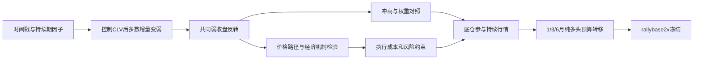

# 股指时间因子与收盘位置研究综述

整理日期：2026-11-04。本文是研究过程、结果与决策的统一记录；本轮只整理和核对已经保存的研究输出，没有新增回测或机制检验，没有读取 2022–2025 样本外和 2026 数据，没有提交或推送。

## 1. 当前决定与研究结论

用户已经确定使用 **rallybase2x**，正式 ID 为 **`index_clv_rally_base_long_2x`**。它是当前唯一注册、已冻结的股指策略：1/3/6 个月趋势决定至多半仓多头底仓，剩余预算在弱收盘时交给 CLV，冲高只将 CLV 预算乘 2，完全不做空。冻结规格见[策略 JSON](../strategies/index_clv_rally_base_long_2x/index_clv_rally_base_long_2x.json)，日常规则说明见[股指策略指南](index_guide.md)。其他已退出实现不恢复。

- 当前冻结版在共同研究期年化净收益 **18.95%**、Sharpe **1.49**、最大回撤 **−14.87%**，平均实际名义敞口 **50.13%**；2021 年 **−1.33%**，没有实现每年为正。
- 研究里最稳定的价格现象是：IF/IH/IC 共同弱收盘后，下一开盘到再下一开盘偏强。早期 IF 没有复制这一现象；原来的时间因子大部分被收盘位置吸收。
- 流动性承接与时段客户换手是相容解释，但融资偿还、会员持仓、盘口和波动等检验没有识别完整的因果链，不能说已经知道由谁支付策略收益。
- 当前规则是用户在收益、持仓参与度和解释方式之间作出的选择，**不是全部历史候选中 Sharpe 最高或回撤最低的一条**。历史纯 CLV 冲高等权为 18.21% / 1.63 / −9.13%，事后固定倾斜为 19.83% / 1.69 / −9.61%，这些比较及其选择偏差均保留在下文。

冻结锁定规则，不产生独立验证。样本外尚未运行；冻结不等于已经授权打开样本外。

## 2. 样本、数据、成本与证据口径

### 2.1 使用了哪些样本

| 样本 | 用途 | 边界和限制 |
|---|---|---|
| 商品 2011–2021 | 最初时间因子的筛查、市场分数及迁移背景 | 本文只记录与股指研究链条有关的发现，不把商品结果当股指验证 |
| IF/IH/IC 共同样本 | 当前策略及主要研究比较 | 输入 2015-04-16 至 2021-12-31，1,638 个交易日；正式账本计分至 2021-12-30，共 1,637 日；末日开盘只结算最后一段 |
| 早期 IF | 检查现象能否向前复制、空头与冲高诊断 | 信号常用 2011-01-04 至 2015-04-14，部分账本计分至 2015-04-15；只一个品种，不能直接和三品种组合比较 |
| 早期现货 | 判断现金市场反转是否比期货更早存在 | 沪深300、上证50、中证500各自可用日历，主要为2005年至2015-04-15；现货指数不可直接按期货成本交易 |
| 2016 起子样本 | 早期机制检验、扩展窗口预测 | 2015 常用于滚动预热或训练；不能与包含2015股灾的全样本混称为同一个检验 |
| 2022–2025 OOS、2026及以后 | 本文不使用 | 不读取行情、因子或已存OOS结果，不补末日收益，不报告样本外表现 |

回归少一段、滚动预热或外部数据覆盖会使观察数不同：例如共同样本弱收盘主回归为1,636个观察，冲高滚动标准化后弱收盘子样本为626日。不能把这些样本数混成同一批独立交易。

### 2.2 不同阶段的账本不能直接排名

早期迁移和候选多用 **1亿元、历史手续费＋每边一跳**，部分起点是2016-01-13，早期容量没有完整施加开仓限额。后期主要比较统一为 **1000万元、开盘后30分钟L1成本、整数手、开仓限额、10%回撤停10日**，共同期从2015-04-16开始。规模会改变取整，成本和限额会改变路径，历史年化16.7%与后期同名规则16.71%不能仅凭数值接近就当成同一实现。

以下均明确区分三类结果：

1. **信号回归和机制检验**：多为未扣成本收益、斜率或概率预测，不能当策略净利润。
2. **完整净账本**：含当时声明的费用、滑点、手数、换月及停机；多条部件账本互相不能相加。
3. **目标或毛归因诊断**：帮助解释预算和价格路径，不是另一条可交易净策略，也不是因果分解。

回归主要用HAC/Newey–West标准误（信号多为5阶，净账本比较常为10阶），但序列相关修正不等于多重检验修正。阈值、形态网格、起点及历次规则都使用重叠研究样本，不能按发表顺序当成独立验证。多数外部变量滞后一交易日；收盘可观测价格特征可含当日，但执行整体延后到下一开盘。

### 2.3 证据来源优先级

当前规则以冻结JSON及代码为准；研究数字优先使用保存的汇总/年度CSV；早期仅剩摘要的实验，明确标为[历史实验记录](guide.md)。有登记、没找到输出的项目单独列出，不补造结果。现有脚本输出路径部分由旧 `runs/index/<研究名>/` 改为 `runs/index/research/<研究名>/`，本文引用实际存在的输出，不能因目录名较旧就视为另一份证据。

## 3. 从日内时间因子走到收盘位置

### 3.1 最初研究的是“什么时候”，不是一开始就认定CLV

动机来自仓库中的[股指时间维度研报](20250225-国泰君安期货-股指策略系列五：时间维度因子在股指期货上的探索与解析.pdf)及[高频时间维度研报](20260609-兴业证券-基于高频时间维度的国债期货择时因子及个股CTA研究.pdf)。本项目实际计算和门槛以[筛查登记](../config/research/time_factor_screen.json)、[时间因子实现](../src/tfcta/factors.py)及[筛查脚本](../research/time_factor_screen.py)为准，未将研报收益直接视为本项目结果。

最初五因子市场分数为：`ts_low`（全天低点越晚偏多）、`ts_high`（全天高点越晚偏空）、`dfp_top3`（收盘低于停留较久价格偏多）、`ts_low_pm`（下午低点越晚偏多）、`ts_high_pm`（下午高点越晚偏空）。

- 高低点时戳按已经走完的分钟位置归一化；下午时戳只在下午区间内计算，盘中决策不能用尚未发生的高低点。
- 持续期使用此前250交易日、不含当天的分钟绝对价格变动第55百分位作阈值；当天持续期最长3个价格点均值作为“公允价”代理，`dfp_top3=(代理价−收盘)/原始收盘`。它是统计代理，不是已识别的基本面公允价值。
- 各品种因子按此前250个有效日（至少125个、不含当天）滚动z-score并截到±3，先在品种内合成，再在市场内等权。方向先固定，不因收益翻号。商品分数要求至少10品种，每品种至少3因子可用；股指只有3个高度相关品种，逐品种结果与共同市场择时分开报告。
- 筛查还比较全天/上午/下午时戳、量额极值时点、成交量过半时点，以及固定价格阈值3点的持续期变体（`dfp_max_fixed`、`dfp_top3_fixed`）。成交量时点的方向没有事先强行指定。

### 3.2 单因子显著，控制后多数消失

首轮同时考察10:00、11:30与收盘决策。下表完整列示已存首轮股指**收盘**筛查的14个变体，格内为“单因子t → 控制后t”；控制变量是当日已形成的涨跌幅、区间收盘位置和对数成交量。盘中时点的完整行仍保存在同一CSV，不将其隐藏为未做过的试验。

| 收盘因子 | IF | IH | IC |
| --- | --- | --- | --- |
| dfp_max | 1.47 → 0.25 | 0.66 → 0.12 | 2.17 → 1.26 |
| dfp_max_fixed | 1.55 → 0.67 | 0.90 → -0.03 | 2.08 → 1.54 |
| dfp_top3 | 2.14 → 1.17 | 0.60 → -0.02 | 2.48 → 1.60 |
| dfp_top3_fixed | 1.32 → 0.17 | 0.67 → -0.31 | 2.49 → 2.16 |
| ts_half_volume | 0.86 → 1.02 | 0.61 → 0.56 | 0.27 → 0.45 |
| ts_high | -0.26 → 2.03 | -0.41 → 1.07 | -1.37 → 0.75 |
| ts_high_am | 1.23 → 1.89 | 0.41 → 1.17 | 1.13 → 1.56 |
| ts_high_pm | -1.52 → 0.79 | -0.20 → 1.03 | -2.11 → 0.35 |
| ts_low | 1.95 → 0.52 | 1.67 → 0.81 | 1.75 → 0.09 |
| ts_low_am | -0.28 → -0.79 | 0.60 → -0.07 | -1.97 → -2.49 |
| ts_low_minus_high | 1.24 → -1.08 | 1.18 → -0.14 | 1.78 → -0.41 |
| ts_low_pm | 3.00 → 1.28 | 2.53 → 1.94 | 1.96 → -0.21 |
| ts_turnover | -0.24 → -0.15 | -0.26 → -0.30 | -0.97 → -0.67 |
| ts_volume | -0.38 → -0.21 | -0.47 → -0.56 | 0.13 → 0.44 |

数据源：[首轮筛查汇总](../runs/commodity/time_factor_screen/summary.csv)。`dfp_top3_fixed` 在IC上控制后t约2.16、达到当轮统计门槛，但不能代表跨品种、跨时期稳定；筛查明确不授权因子配对（`允许配对=False`）。这些是多因子、多时点检查后的局部结果，没有因此把时间戳加入当前冻结策略。

商品市场分数与平均CLV相关约−0.925；分数单独择时日差约+7.7bp（t2.56），控制CLV后只剩+0.3bp（t0.06）。股指迁移中分数单独t2.37，加入CLV后t−0.63。两组来自历史实验记录，说明最初五因子很大程度在描述当天价格落在区间的什么位置，而不是证明“时间”有额外收益来源。

因此研究主线从“时间因子本身有效”转向“市场级弱收盘后的短期反转”。此后仍专门检查时间/路径特征的增量，不把第一次发现作为终点。

### 3.3 最初迁移与简单CLV候选并非一次成功验证

在1亿元、每边一跳的早期口径中，先把原五因子市场分数迁移至股指，再直接检验共同CLV<0.5。共同日历用于预热，因持续期等滚动因子需要历史，策略首个非零目标在2016-01-13；不能把此前时间当成该策略持仓表现。

| 2016-01-13至2021-12-30，早期口径 | 年化净收益 | Sharpe | 最大回撤 | 说明 |
|---|---|---|---|---|
| 原五因子市场分数多头腿 | 12.78% | 1.10 | −9.53% | 迁移研究；alpha NW t约2.07 |
| 原分数加三窗口趋势空头 | 11.93% | 1.03 | −10.41% | 加空头没有改善；alpha t约1.94 |
| 简单共同CLV<0.5多头 | 19.79% | 1.47 | −16.84% | 扣成本、同10%停机；6年中5年为正 |
| 同风控等权长仓 | 8.73% | 0.57 | −28.64% | 与CLV候选的成本和停机口径一致 |

来源：[原市场分数迁移](../runs/index/market_clock_transfer_2015_2021/summary.csv)、[简单CLV候选](../runs/index/index_close_location_candidate/summary.csv)。CLV候选减同风控等权的日差t约1.52，未达到登记t≥2，所以当时整体判定未通过。后来同平均敞口的对照给出更强差值，并不使原满仓对照的失败消失。起点扩回2015后候选最大回撤约−33%，也暴露了当时高波动和容量问题。

## 4. CLV本身的证据、阈值与复制

`CLV=(closew−loww)/(highw−loww)`。当前信号是IF/IH/IC各自CLV的等权平均；三品种都必须有效、区间严格为正。它衡量相对位置，不是当天收益符号：高开回落也可能是弱收盘。

### 4.1 核心主检验

在收盘已知后预测下一开盘到再下一开盘，而不把信号后立即发生、进场前的跳空算成可赚收益。阈值曾比较0.3/0.4/0.5，共同样本弱收盘减其他日的NW t依次2.45/3.03/2.76，2016起为3.78/4.03/3.69，因此0.4有研究期选择成分。

后来的登记归因复核得到：共同样本弱收盘虚拟变量系数 **+23.74bp、t3.03、7/7年同向**，最低五分位减最高五分位约29.2bp；早期IF **−0.65bp、t−0.07、3/5年同向**。7/7指回归系数符号，不是策略每年盈利，更不是当前2倍规则的7次独立验证。来源：[机制复核表](../runs/index/research/index_adaptive_attribution/mechanism_tests.csv)。

相对位置与绝对幅度的历史诊断：CLV斜率约−41.6bp（t−3.35），控制振幅后约−41.8bp（t−3.37），振幅本身t−0.3；最低两分组收益约+26/+18bp，高CLV组约−5bp且不显著，更接近单边弱收盘反弹，而非对称多空。`d_low`、`d_high`与振幅联合控制后没有稳定取代CLV。来源为历史实验记录中的 `index_close_location_shape`，本轮未找到其独立输出目录，未重新计算。

早期还试过CLV门槛0.3至0.7、按`0.5−CLV`线性加仓及振幅开关。0.3–0.5是较宽平台，0.5以上变差，没有变体相对0.5基线稳定显著占优；线性或振幅门槛往往同时降低beta与收益。不能把0.4描述成理论推导出的唯一正确阈值。

### 4.2 是共同市场反转，不是挑出反弹最强的品种

共同CLV预测IF/IH/IC下一段收益的历史斜率约−39/−40/−46bp，波动标准化约−0.25/−0.28/−0.27，差异很小。各品种自身CLV给出的IC较强、IH较弱，部分来自信号噪声不同；不应直接推导为超配IC。

旧带展期策略改用各品种自己的CLV，组合Sharpe由0.88降至0.78；后期1000万/L1的独立品种CLV版本为12.93% / 1.00 / −19.42%，共同CLV冲高等权为18.21% / 1.63 / −9.13%。三品种不是三个独立市场复制。

专门登记的分歧检验在弱收盘日比较“几个品种CLV<0.4”与CLV离散度，并控制CLV、波动等、作Holm两项修正：共同2015起，弱品种数系数t−1.68（预期正），离散度t+1.49（预期负），校正p均1；2016起分别−0.49/−0.11。没有支持“越一致越反弹”的仓位条件；早期IF只有一个品种，不能检验三品种分歧。来源：[分歧回归](../runs/index/index_short_risk_disagreement/disagreement_regressions.csv)。

### 4.3 向前看现金市场与期货，不能混成成功复制

早期现货开盘到收盘的CLV斜率t−2.83，2016以后t−4.24，两段差t−0.95；但是在2010-04至2015-04的同日并排样本，现货t−1.09、IF盘中t−0.63、IF下一开盘段t−0.08。开盘质量检查没有发现大量“开盘等于前收”的机械问题。结论是现金市场某些较早窗口有反转，不代表早期IF可交易持有段通过复制。来源：[长样本斜率](../runs/index/index_spot_long_sample/slopes.csv)、[开盘质量](../runs/index/index_spot_long_sample/open_quality.csv)。

## 5. 如何区分反弹日：量价、路径与冲高

### 5.1 八个日线特征的扩展窗口分类

特征包括5/20日动量、隔夜跳空、日内收益、相对振幅、相对量、带方向的相对量和Amihud代理。先控制CLV做HAC增量回归，再按年份扩展训练、预测2016–2021，不用同一年的未来标签训练。八项交互的全样本t约在−1.49到+1.01之间，BH校正q均约0.94。

弱收盘合并预测如下。AUC越高、Brier越低越好；各候选使用自己的可用行基线，不能交叉拿基线作改善。最后一项只有338个观察，其余571个。**这一组八特征不含冲高。**

| 候选 | AUC：CLV基线→加入候选 | Brier：基线→候选 | 观察数 |
| --- | --- | --- | --- |
| ret_5d | 0.481 → 0.492 | 0.2473 → 0.2480 | 571 |
| ret_20d | 0.481 → 0.470 | 0.2483 → 0.2539 | 571 |
| overnight_gap | 0.481 → 0.464 | 0.2479 → 0.2510 | 571 |
| intraday_return | 0.481 → 0.470 | 0.2479 → 0.2482 | 571 |
| range_surprise | 0.484 → 0.515 | 0.2485 → 0.2488 | 571 |
| volume_surprise | 0.481 → 0.505 | 0.2483 → 0.2485 | 571 |
| signed_volume_surprise | 0.481 → 0.493 | 0.2483 → 0.2488 | 571 |
| amihud_surprise | 0.455 → 0.465 | 0.2499 → 0.2518 | 338 |

来源：[弱收盘预测](../runs/index/index_close_discriminators/weak_close_walk_forward.csv)。八个候选合并Brier均恶化，不能据AUC某项略升就加仓。相对振幅高组的平均收益约27.7bp、低组23.5bp、中组13.1bp，但2018与2021等年份不稳定；早期IF各组反弹率约46%–50%，没有获得可迁移的振幅过滤。

### 5.2 冲高：回归增量、概率预测和加仓账本是不同检验

冲高幅度为 `(highw−openw)/raw_open`，用此前60日、至少40日的均值和标准差归一化，不含当前日。弱收盘且z>0时才放大CLV，不是所有上冲日都买入。

六个价格极值候选（相对开盘和TWAP的高点、低点、振幅）的主要回归结果如下：

| 候选 | IF2011–2021弱收盘t | q | 三品种共同弱收盘t | q |
| --- | --- | --- | --- | --- |
| high_open | 4.25 | 0.000 | 2.83 | 0.029 |
| low_open | 0.49 | 0.622 | 1.88 | 0.182 |
| range_open | 1.94 | 0.100 | 0.94 | 0.532 |
| high_twap | 1.20 | 0.278 | 0.74 | 0.532 |
| low_twap | -2.15 | 0.095 | -0.63 | 0.532 |
| range_twap | 1.84 | 0.100 | 0.82 | 0.532 |

来源：[价格极值主检验](../runs/index/index_price_extremes/primary_effects.csv)。共同弱收盘中冲高每1标准差约+72.35bp、t2.83、q0.029；但IF2011–2021与共同2015–2021重叠，不能算独立早期复制。单独早期IF冲高复核t约1.93，联合开盘位置与振幅后接近零。共同样本联合控制后冲高t约2.59，仍未识别唯一渠道。

后续**专门包含冲高**的路径/量能分类也没有稳定改善Brier：这与上一组八日线特征不是同一个检验。

| 样本 | 模型 | AUC | Brier | 相对CLV的ΔBrier |
| --- | --- | --- | --- | --- |
| IF 2011–2015 | CLV基线 | 0.492 | 0.2502 | +0.0000 |
| IF 2011–2015 | CLV+高点−开盘 | 0.478 | 0.2525 | +0.0023 |
| IF 2011–2015 | CLV+成交量持续期收益 | 0.480 | 0.2507 | +0.0005 |
| IF 2011–2015 | CLV+两候选 | 0.473 | 0.2528 | +0.0026 |
| IF/IH/IC 2016–2021 | CLV基线 | 0.482 | 0.2452 | +0.0000 |
| IF/IH/IC 2016–2021 | CLV+高点−开盘 | 0.481 | 0.2608 | +0.0156 |
| IF/IH/IC 2016–2021 | CLV+成交量持续期收益 | 0.467 | 0.2646 | +0.0194 |
| IF/IH/IC 2016–2021 | CLV+两候选 | 0.495 | 0.2690 | +0.0238 |

来源：[路径量能预测](../runs/index/index_path_volume_discriminators/walk_forward.csv)。早期IF以2011作首折训练，分类实际向前预测2012–2015；后期以2015训练、预测2016–2021。成交量持续期收益（原特征ID `Volume_duration_return`）没有稳定增量；冲高交互在后期t2.58、早期t0.81。条件均值斜率、正收益概率预测和完整加仓净账本检验目标不同，不能挑其中一个替代另外两个。

### 5.3 弱收盘形态的五个预期方向

又检查开盘位置、最高点时刻、持续期公允价偏离、低位停留占比、信息离散度。共同样本主要是开盘位置较低时反弹更强；早期不复制，其他特征不稳健。

| 特征 | 预期方向 | 共同弱收盘t | 共同q | 早期IF t | 早期q |
| --- | --- | --- | --- | --- | --- |
| open_location | − | -3.11 | 0.010 | -0.32 | 0.850 |
| high_time | + | 0.42 | 0.918 | -0.48 | 0.850 |
| dfp_top3 | + | -0.34 | 0.918 | 2.23 | 0.131 |
| low_dwell | − | -0.52 | 0.918 | 0.19 | 0.850 |
| info_discreteness | + | 0.04 | 0.968 | -0.46 | 0.850 |

来源：[弱收盘形态检验](../runs/index/index_weak_close_shape/tests.csv)。开盘位置共同样本三组平均约26.2/34.5/3.4bp，但早期约8.7/0/8.7bp；不存在简单单调且可迁移的阈值。控制价差及QVIX后开盘位置仍t约−2.70，不等于该变量已经被流动性机制解释。早期dfp_top3局部t2.23、q0.131，也不能忽略多重检验和后期失败。当前冻结规则没有再加这些日内形态条件。

## 6. 经济原理怎样被逐条检验

### 6.1 机制是假说链，不能用几个显著t拼成因果

最初假说为：短期卖出需求把价格压到区间低位 → 承接者承担库存与融资风险 → 压力消退或客户换手后价格修复 → 策略在下一开盘后获得尚未完成的补偿。[Nagel的流动性补偿框架](https://www.nber.org/papers/w17653)和[Lou、Polk、Skouras的隔夜/日内客户群研究](https://personal.lse.ac.uk/polk/research/TugOfWar.pdf)提供解释方向，但文献对象和国内期指不同，需要自己的价格、数量和时段预测都成立。

下面依“假说—应看到什么—实际结果—结论”汇总。t的符号遵循原模型：CLV斜率为负意味着收得越低、之后越强，不能把负t直接说成策略亏损。

| 假说 | 关键可证伪预测 | 已有结果 | 结论 |
|---|---|---|---|
| 只是买卖价反弹 | 中间价CLV应不再预测 | 成交价与中间价斜率几乎相同，次日盘中t约−2.72/−2.71 | 不支持“全部只是成交价弹回”，未排除所有微观结构影响 |
| 尾盘流动性压力 | 弱收盘时盘口更差，且越差越反转 | 2016起：尾盘/全天价差比差异t+6.60，深度比t−3.82；CLV×深度变薄t−2.24，但价差/成交流交互t−0.39/+0.71 | 有共现和部分交互证据，没有完整确认 |
| 基差错价修复 | 弱收盘后的期货相对现货回升应留在持有期 | 2016起：基差整体回升t约−7.1，但几乎全在信号收盘到进场前的隔夜t−8.8，盘中部分回落t+2.5 | 修复时段不能计入下一开盘才进入的策略收益 |
| 做市/库存快速出清 | 成交流量推动的部分应很快回复 | 2016起：流量与非流量分解t约−0.6/−0.9，CLV仍约−2.6；开盘半小时不强、之后更强 | 没有支持快速库存回补渠道 |
| 现货T+1开盘卖压 | 下一开盘半小时继续卖、随后被接住 | 2016起：半小时收益对CLV t+0.76；半小时成交占比t+4.25、方向相反；开盘收益对后续收益t+2.33为延续，控制后CLV斜率不缩小 | 预先预测没有通过 |
| 尾盘集中冲击/尾盘护盘 | 信号日尾盘跌幅最有预测、次日尾盘反弹最强 | 2016起：信号日下午11:30–14:30 t−2.3，尾盘约−0.3；次日11:30–14:30 t−3.4，14:30后约−1.1 | 不支持把收益归为尾盘砸盘或次日尾盘托底 |
| 下午时段跨日修复 | 同一时段跌幅次日回补 | 事后同下午时段收益t−4.6，控制它后CLV对该段增量t0.07 | 与时段反转相容，但属事后解释，不是独立新验证 |
| 大会员加空再回补 | 弱收盘日前20名净空增加，次日买回 | 弱收盘日净多反而增加t−5.8，2016起−6.4；次日卖回t+2.9/+4.9 | 原“机构加空回补”方向被否定 |
| 卖压超过会员承接能力 | 未被接住那一组反弹应稳定更强 | 原分组约−43bp对+8bp，但后续全样本两组差t−0.7；2016起差t约1.2或0.7 | 不支持“只有没接住才反转”的交易条件 |
| 多头被迫平仓 | 减仓日应比增仓日反弹更多 | 持仓增减交互t约±0.7；早期量代理和移仓效应也未稳定支持 | 不确定，未识别被迫卖方 |
| 融资去杠杆推动反弹 | 卖得越多，随后补偿越大 | 弱收盘日融资偿还更多t−7.60；指数层偿还×CLV主交互t−0.10，含2015为+0.42；低/中/高偿还组盘中11.3/11.9/6.2bp | 卖压共现成立，数量越大补偿越高未成立 |
| 个股融资偿还 | 被迫偿还股票应反弹更多，且弱市场更明显 | 弱市场个股偿还系数约+1.6bp/标准差、t3.2；强市场也有+0.9bp、t2.2，差t1.1 | 不能把个股现象当成市场CLV的独有机制 |
| 北向资金承接 | 弱收盘日卖出、次日买回应解释反弹大小 | 当天卖/次日买的共现t约5.4/−2.4；交互约0.5，个股持仓变化也未稳定解释，部分结果更像延续 | 没有形成可以下单的资金条件 |
| 波动风险补偿 | 同样弱收盘，高风险时反弹应更大 | RV交互2016起约−1.9，含2015明显减弱；完整可交易段收益对波动分位t0.63、584观察 | 完整样本未稳健通过 |
| QVIX恐慌补偿 | 隐含波动越高，反转越强 | 2016起CLV×QVIX t−2.16，含2015为−0.88；毛反转对QVIX t2.23/0.93，五档不单调 | 2016子样本方向支持，不能推广全样本或直接设开关 |
| 散户/小盘过度反应 | IC应比IH稳健更强 | 自身CLV下IC较强，但共同CLV波动标准化差很小；个股小盘与大盘反弹差t约−0.1 | 不能据此把IC倾斜解释成已验证的散户溢价 |
| 节前避险/收盘制度 | 节前或收盘集合竞价变更应改变斜率 | 节前交互约0.4；2018-08收盘竞价交互约0.4，IH−IC差约−1.1 | 未支持相应机制 |

来源分别为已有[盘口汇总](../runs/index/index_close_location_mechanism/summary.csv)、[期现/流量检验](../runs/index/index_liquidity_mechanism/predictions.csv)、[会员持仓](../runs/index/index_positioning_mechanism/predictions.csv)、[未承接压力](../runs/index/index_unabsorbed_pressure/predictions.csv)、[现货开盘](../runs/index/index_spot_open_pressure/predictions.csv)、[时段渠道](../runs/index/index_reversal_channels/tests.csv)、[个股流动性与偿还研究](../runs/index/index_liquidity_provision/tests.csv)、[融资数量](../runs/index/index_forced_selling/tests.csv)、[QVIX](../runs/index/index_qvix_reversal/tests.csv)及对应登记。个股研究另有[预登记](../config/research/index_liquidity_provision.json)。包含不同起点和结果段，表中的显著t不能累加成一个总体显著性。

会员是期货公司名下许多客户的合计，不是单个交易者；前20名约覆盖62%–69%持仓。“外部会员净变化”和“前20名净变化”的相反数存在持仓恒等关系，不能伪装成两个独立压力变量。融资个股截面和市场汇总也不是同一检验。

### 6.2 现货、期货与策略实际持有段

[Qiao和Dam关于T+1与隔夜收益的研究](https://research.rug.nl/en/publications/the-overnight-return-puzzle-and-the-t1-trading-rule-in-chinese-st/)提供制度背景，不足以替代上表失败的开盘卖压预测。已有现货检验显示隔夜继续低开（CLV斜率t+3.10），次日10:00后反弹（t−4.26，2016起6/6年同向），但期货可交易持有段需要单独检验：

| 期货弱收盘后的持有段 | 平均毛收益 | NW t | 同向年数 | 观察数 |
| --- | --- | --- | --- | --- |
| 开盘到0931 | 3.72bp | 5.13 | 7/7 | 642 |
| 0931到收盘 | 3.70bp | 0.64 | 4/7 | 642 |
| 收盘到次日开盘 | 12.38bp | 4.16 | 7/7 | 642 |

登记要求“09:31之后的盘中部分t≥2”，实际只有0.64，因此T2没有通过。不能把现货10:00后的显著反弹，直接当成期货晚于09:31的显著收益；当前L1成本估计也不等于保证在开盘第一分钟按理想价成交。

QVIX按年标准化或滚动分位的改法，是看到绝对水平全样本失败后提出的。它们可以解释为什么2015与其后不同，但年内标准化若含未来不能直接当可交易信号。本文不把聊天中未找到完整对应结果的QVIX仓位开关数字写成已复核结论；当前规则不使用QVIX开关或乘数。

### 6.3 目前只能下到哪一级结论

可以确认的是研究样本内的价格关联，以及某些压力和承接指标的共现。尚未确认的是：到底谁被迫交易、为何这笔交易在之后产生可赚补偿、为什么完整样本风险补偿不单调、为什么早期IF没有复制。

“流动性压力”“信息重估”“时段客户群”仍是竞争解释。没有识别全部渠道，不代表价格回归数值不存在；有一项显著价格回归，也不证明某个付款账户已被识别。当前策略按经验规则冻结，而非按一条已完成因果实证的经济定律部署。

### 6.4 已登记但本轮没找到独立输出的研究

| 项目 | 已写下的假说/实现 | 目前可报告的状态 |
|---|---|---|
| 日内承接成本制度 | [登记](../config/research/index_intraday_cost_regime.json)：平今成本和限额变化可能使修复由当日移到次日，检查11:30/14:30位置及制度交互，排除过渡期，作Holm修正 | 有登记与研究代码，本轮未找到其regressions/annual输出；不写成通过或失败，不重跑填补 |
| 品种分配与2018/2021状态 | [登记](../config/research/index_allocation_regimes.json)：相对动量、相关、CLV离散、固定权重向等权收缩，以及分品种毛归因 | 当前独立输出目录未找到；旧实验记录与后面已保存的权重对照可以引用，但不能编造该登记下每张表的数值 |
| 相对位置细分 | [登记](../config/research/index_close_location_shape.json)：CLV、距高低点幅度、振幅及风格/节前渠道 | 关键结果保存在历史实验记录，独立目录本轮未找到；与有CSV直接核对的试验区分 |

这些是证据可追溯性的缺口，不能用“有脚本”替代“已经跑出并核对结果”。

## 7. 空头、展期、品种权重与持有基准

### 7.1 为什么做了空头的干净对照

早期对照经常同时改变空头和波动缩放，无法识别空头的作用。后来登记2×3：冲高保留/关闭 × 原空头/无空头/仅低波空头，所有多头目标、波动缩放、成本和停机保持一致，共同三品种和早期IF各六本账。低波空头只保留原熊市且CLV不弱的空头日，再要求RV20低于此前250个完整RV20的中位数，预热不足不做该空头。

保险判定事先要求：两个样本都将最大回撤绝对值降低至少20%，年化收益少不超过2个百分点。该容忍度是研究者登记的暂定条件，不代表用户永久风险偏好。

| 样本/变体 | 年化净收益 | Sharpe | 最大回撤 | 空头持仓日 |
| --- | --- | --- | --- | --- |
| 共同_保留冲高_原空头 | 20.95% | 1.68 | -11.86% | 189 |
| 共同_保留冲高_无空头 | 18.21% | 1.63 | -9.13% | 0 |
| 共同_保留冲高_低波空头 | 15.51% | 1.38 | -12.25% | 48 |
| 共同_关闭冲高_原空头 | 16.71% | 1.53 | -11.60% | 189 |
| 共同_关闭冲高_无空头 | 14.47% | 1.50 | -9.52% | 0 |
| 共同_关闭冲高_低波空头 | 11.38% | 1.19 | -12.34% | 48 |
| 早期IF_保留冲高_原空头 | 3.51% | 0.30 | -32.01% | 291 |
| 早期IF_保留冲高_无空头 | 2.63% | 0.27 | -22.56% | 0 |
| 早期IF_保留冲高_低波空头 | 1.36% | 0.16 | -32.13% | 137 |
| 早期IF_关闭冲高_原空头 | 1.83% | 0.20 | -30.89% | 291 |
| 早期IF_关闭冲高_无空头 | 2.00% | 0.23 | -20.37% | 0 |
| 早期IF_关闭冲高_低波空头 | 1.15% | 0.15 | -25.86% | 136 |

来源：[空头干净对照](../runs/index/index_short_risk_disagreement/summary.csv)、[配对比较](../runs/index/index_short_risk_disagreement/comparison.csv)、[保险判定](../runs/index/index_short_risk_disagreement/insurance_verdict.csv)。所有原空头/低波空头保险判定均失败。共同样本保留冲高时原空头相对无空头收益差t1.18、不显著且回撤更深；低波空头相对无空头t−2.21。早期两者差也不显著。不能因某一熊市年度做空赚钱，就认定整本空头有稳定保护。

更早1亿元一跳口径也比较过带展期空头和纯趋势空头：2016起候选19.8%/1.47/−16.8%，加带展期空头16.5%/1.34/−14.0%，加纯趋势空头12.5%/0.96/−12.9%；早期全样本含股灾时回撤仍约−33.4%。这些是历史口径，不和上表净值直接拼接。[Daniel与Moskowitz的动量崩溃研究](https://www.nber.org/papers/w20439)提示急反弹风险，但其主要对象是横截面动量，不能照搬为这里空头有效的证据。

### 7.2 三个品种从2015到2021一直持有怎样

这次使用同一研究日历、1000万单品种独立账、历史成本和L1，初始近似1倍后持有手数，不使用策略的波动缩放和10%择时停机。净值展示至2021-12-31最后开盘结算，账本结果日仍至2021-12-30。

| 持有品种 | 累计净收益 | 年化净收益 | Sharpe | 最大回撤 |
| --- | --- | --- | --- | --- |
| IF | 46.11% | 5.77% | 0.38 | -40.04% |
| IH | 22.84% | 3.09% | 0.25 | -41.24% |
| IC | 66.50% | 7.83% | 0.45 | -43.91% |

来源：[BH汇总](../runs/index/index_buy_hold_carry/summary.csv)。三本都经历2015下跌和很深的途中回撤；IC最终累计更高，不能推出持有过程更平稳。单品种各1000万，与三品种共用1000万的整数手基准不同，不能简单平均成当前策略报告里的等权买入持有。

### 7.3 展期到底测了什么

使用的是**主力对更远合约的年化期限结构**，不是期货相对现货贴水：`(主力结算−更远合约结算)/更远结算×365/到期日差`，更远合约选到期晚于主力且当日持仓量最大的合约。不能把该因子直接加进盈亏，或将IC约99.57%的正展期率等同于99.57%的现货贴水日。

动态排序在信号日用t−1外部展期、t+1执行，所以执行日乘数为 `carry.shift(2)`；低/中/高乘数0.5/1/1.5，并列取平均秩、和为3，只改已有正目标、负目标不变，总正预算不增加。按当时登记审计逐年覆盖，缺任一品种当日全部等权并报告，不根据收益删日期。

固定对照乘数为IF **0.8917445**、IH **0.6238318**、IC **1.4844237**，约占预算29.72%/20.79%/49.48%。它来自全研究期642个计划多头执行日的动态乘数按天平均，不是收益优化，也不是只对实际成交日或按资金加权。**它在2015年事前未知，是事后风格对照，不是可按当时信息实施的固定权重回测。** IC在约97.66%计划多头日排名最高，动态方案大部分时间只是在偏配IC。

| 规则组 | 品种分配 | 年化净收益 | Sharpe | 最大回撤 |
| --- | --- | --- | --- | --- |
| 含历史空头 | 等权 | 20.95% | 1.68 | -11.86% |
| 含历史空头 | 动态展期 | 22.43% | 1.73 | -11.53% |
| 含历史空头 | 固定平均权重 | 22.46% | 1.74 | -11.06% |
| 无空头 | 等权 | 18.21% | 1.63 | -9.13% |
| 无空头 | 动态展期 | 19.63% | 1.67 | -9.08% |
| 无空头 | 固定平均权重 | 19.83% | 1.69 | -9.61% |

来源：[含空头展期对照](../runs/index/index_buy_hold_carry/comparison.csv)、[无空头展期对照](../runs/index/index_carry_long_only/comparison.csv)。含空头动态减固定t−0.02，无空头动态减固定t−0.42，均没有通过“t≥2、至少5/7年差为正”的动态选择标准。无空头动态减等权t1.48，固定减等权t1.72，也没有得到稳健增益。当前冻结版选择等权，不使用动态展期或事后固定IC倾斜。

另做过20日相对收益排名与波动倒数，在后期可比口径分别为17.55%/1.53/−9.90%、17.25%/1.56/−9.93%，未超过等权18.21%/1.63/−9.13%。更早500日滚动预测强弱、波动平价、IC1.5/IF1/IH0.5、去掉IH、只做IC等亦未稳定改善配对收益，偏IC主要加了beta和回撤。相对胜率动态择时没有被当成新的收益来源。

### 7.4 曾经按“每年为正”选过十个候选

用户曾优先要求年度稳定。已登记的排序先看正收益年数，再看最差年度、年度收益标准差、整段回撤与Sharpe。完整十个候选如下，不能只留后来选中的一行：

| 当时的候选 | 年化 | Sharpe | 最大回撤 | 正收益年数 | 最差年度 | 年收益样本标准差 |
| --- | --- | --- | --- | --- | --- | --- |
| 无空头_固定平均权重 | 19.83% | 1.69 | -9.61% | 7/7 | 0.40% | 12.95个百分点 |
| 无空头_动态展期 | 19.63% | 1.67 | -9.08% | 6/7 | -0.60% | 12.84个百分点 |
| 共同_保留冲高_无空头 | 18.21% | 1.63 | -9.13% | 6/7 | -1.23% | 11.98个百分点 |
| 共同_关闭冲高_无空头 | 14.47% | 1.50 | -9.52% | 6/7 | -1.51% | 9.81个百分点 |
| 含空头_固定平均权重 | 22.46% | 1.74 | -11.06% | 6/7 | -4.69% | 16.04个百分点 |
| 含空头_动态展期 | 22.43% | 1.73 | -11.53% | 6/7 | -5.18% | 16.17个百分点 |
| 共同_关闭冲高_原空头 | 16.71% | 1.53 | -11.60% | 6/7 | -6.02% | 13.50个百分点 |
| 共同_保留冲高_原空头 | 20.95% | 1.68 | -11.86% | 6/7 | -6.23% | 16.07个百分点 |
| 共同_保留冲高_低波空头 | 15.51% | 1.38 | -12.25% | 6/7 | -8.43% | 13.62个百分点 |
| 共同_关闭冲高_低波空头 | 11.38% | 1.19 | -12.34% | 6/7 | -8.60% | 10.98个百分点 |

来源：[完整候选排序](../runs/index/index_final_selection/ranking.csv)、[逐年净收益](../runs/index/index_final_selection/annual_returns.csv)、[逐年Sharpe](../runs/index/index_final_selection/annual_sharpe.csv)。当时固定倾斜是唯一7/7正收益候选：最差2021仅约+0.40%，最好年度约+38.56%，年度收益样本标准差12.95个百分点。它既非每年接近同一收益，也有全样本事后权重与看过结果后提出选择偏好的偏差。后来为了参与持续上涨、提高持仓而继续改底仓，不能抹去这个历史结果，也不能称当前2倍版是按十候选同一标准胜出。

## 8. 冲高、单边上涨与自适应部件怎样取舍

### 8.1 冲高加仓要和同敞口对照比较

单纯放大仓位会增加收益，故历史冲高研究另设同平均敞口的固定放大对照。共同样本原规则为16.71%/1.53/−11.60%，冲高×1.5为20.95%/1.68/−11.86%，同敞口固定放大为18.10%/1.53/−12.62%。

冲高减同敞口对照日均约+1.01bp、t **2.80**、6/7年为正；早期IF差为正但t1.29。按照当轮“共同t≥2且早期差为正”的登记标准记为支持。剔除最大10个差值日后，共同t降至1.18，早期差转负、t−0.78，提示收益集中。不能因为原判定通过就忽略尾部几天依赖。来源：[冲高账本](../runs/index/index_path_rally_tilt/summary.csv)、[同敞口比较及集中度](../runs/index/index_path_rally_tilt/comparison.csv)。

### 8.2 自适应策略的阶梯与去一法

后来在弱收盘上叠加跳过单边下跌、加入单边上涨、20日收益排名和EWMA。登记后逐步加件及去一法复核，全部是历史自适应账本，不是当前rallybase2x的因果归因。

| 历史部件账本 | 年化净收益 | Sharpe | 最大回撤 |
| --- | --- | --- | --- |
| 核心 | 14.47% | 1.50 | -9.52% |
| +冲高 | 18.21% | 1.63 | -9.13% |
| +跳过单边下跌 | 17.35% | 1.70 | -8.45% |
| +单边上涨 | 21.10% | 1.65 | -10.98% |
| +收益排名分配 | 20.71% | 1.58 | -13.28% |
| +EWMA（完整） | 19.38% | 1.53 | -13.16% |
| 完整−冲高 | 15.40% | 1.55 | -10.05% |
| 完整−跳过单边下跌 | 18.23% | 1.41 | -12.12% |
| 完整−单边上涨 | 17.00% | 1.69 | -7.42% |
| 完整−收益排名分配 | 19.21% | 1.56 | -13.60% |
| 完整−EWMA | 20.71% | 1.58 | -13.28% |
| 等权买入持有 | 5.34% | 0.38 | -36.10% |
| 同敞口买入持有 | 3.48% | 0.38 | -21.93% |

| 逐日净差比较 | 算术年化差 | NW t | 正差年数 |
| --- | --- | --- | --- |
| +冲高 − 核心 | +3.34个百分点 | 3.69 | 6/7 |
| +跳过单边下跌 − +冲高 | -0.82个百分点 | -0.52 | 3/7 |
| +单边上涨 − +跳过单边下跌 | +3.40个百分点 | 1.34 | 4/7 |
| +收益排名分配 − +单边上涨 | -0.28个百分点 | -0.30 | 2/7 |
| +EWMA（完整） − +收益排名分配 | -1.16个百分点 | -2.00 | 3/7 |
| 完整 − 去掉冲高 | +3.66个百分点 | 2.88 | 6/7 |
| 完整 − 去掉跳过单边下跌 | +0.91个百分点 | 0.46 | 3/7 |
| 完整 − 去掉单边上涨 | +2.27个百分点 | 0.89 | 3/7 |
| 完整 − 去掉收益排名分配 | +0.18个百分点 | 0.24 | 4/7 |
| 完整 − 去掉EWMA | -1.16个百分点 | -2.00 | 3/7 |

来源：[部件完整账本](../runs/index/research/index_adaptive_attribution/components.csv)、[阶梯与去一法](../runs/index/research/index_adaptive_attribution/component_steps.csv)。冲高是历史核心增量；跳过单边下跌、收益排名和EWMA并无稳健增益，单边上涨的增量t约0.89–1.34，不够稳健。两种冲高拆法用同一批行情，不能当两次验证，更不能将其增量直接套在当前动态底仓上。

同敞口常数仓位在1000万、整数手下约每品种1手，随价格上涨甚至可取整为0；当时看到这一问题后，T4改为按实现平均敞口比例缩放买入持有的日收益。这是看过结果后的对照口径修订，已在登记注明。历史自适应完整账对该缩放序列日差t3.39、beta约0.329、alpha检验t4.15，不能把缩放序列当另一条无摩擦可交易组合。

### 8.3 九组单边上涨网格，全部报告

为了接住持续上涨，额外试验实体占比门槛0.6/0.7/0.8 × pooled CLV门槛0.8/0.9/1.0，共9格。用的是带排名和EWMA等部件的自适应基线，绝不是当前底仓的最佳参数搜索。

| 实体门槛 | CLV门槛 | 累计净收益 | 年化 | Sharpe | 最大回撤 | 新增信号日 |
| --- | --- | --- | --- | --- | --- | --- |
| 0.6 | 1.0 | 192.76% | 17.21% | 1.71 | -7.31% | 1 |
| 0.7 | 1.0 | 192.76% | 17.21% | 1.71 | -7.31% | 1 |
| 0.8 | 1.0 | 192.76% | 17.21% | 1.71 | -7.31% | 1 |
| 0.7 | 0.8 | 231.39% | 19.38% | 1.53 | -13.16% | 132 |
| 0.8 | 0.8 | 183.88% | 16.68% | 1.48 | -11.63% | 74 |
| 0.8 | 0.9 | 173.02% | 16.01% | 1.45 | -11.34% | 53 |
| 0.7 | 0.9 | 193.48% | 17.25% | 1.45 | -9.95% | 77 |
| 0.6 | 0.8 | 215.89% | 18.54% | 1.45 | -16.79% | 177 |
| 0.6 | 0.9 | 177.61% | 16.29% | 1.37 | -12.08% | 96 |

来源：[九格结果](../runs/index/research/index_adaptive_signal_grid/summary.csv)。总收益最高是body>0.7且CLV≥0.8，新增132日；Sharpe最高的CLV≥1.0三格实际上只多1日，结果相同。按总收益选的格子并非Sharpe赢家，回撤也更深。该门槛后来放在等权历史版本出现21.59%/1.60/−11.39%，2021却−3.29%；不能把两个基线的数字混成同一九格试验。

2021-03-04旧账实例中前日CLV约0.93、实体0.91，执行日仍亏约2.70%；它只是说明强收盘不能识别信息延续或冲顶，不是新日历过滤的依据。当前取消单边上涨，改用底仓参与持续行情。

### 8.4 选择偏差的登记审计

历史11条阶梯/去一法净收益估算DSR约1.000，但16段CSCV得到PBO约0.690。不能只取乐观的DSR；试验族尚不包含所有早先阈值、九格和已删除候选，实际选择次数被低估，结果偏乐观。这些都是历史自适应账本的审计，不是当前2倍版已通过的独立过拟合检验。

## 9. 为什么又做底仓：从参与行情到动态预算

纯CLV只有弱收盘时持有，历史等权版平均实际敞口33.54%，可能错过持续上涨。用户要求将预算分两部分，让底仓参与趋势、CLV继续反转。这个目标不是简单加一笔免费收益：若从原CLV预算中拿走一半给趋势，趋势必须补回减少的反转收益，持仓增加本身不代表质量改善。

### 9.1 依次看过的底仓方案

| 底仓设计 | 年化净收益 | Sharpe | 最大回撤 | 留下的认识 |
|---|---|---|---|---|
| 无底仓、全部用于共同CLV冲高 | 18.21% | 1.63 | −9.13% | 反转收益集中，但持仓参与较少 |
| 常驻+0.5，另一半CLV冲高 | 13.99% | 1.22 | −17.14% | 参与上涨，也带来熊市方向风险；2018 −9.16% |
| EMA20>EMA60持有+0.5，否则空仓 | 13.25% | 1.35 | −9.96% | 2018 +2.72%，2021 −1.80%；不是未看过样本上的验证 |
| MACD(12,26,9)底仓±0.5 | 8.18% | 1.02 | −12.87% | MACD柱测趋势强度变化，上涨放缓也可能翻空；2017 −1.98%、2021 −9.63% |
| 63/126/252日多数表决±0.5 | 10.72% | 1.09 | −10.30% | 比MACD更接近中期方向，但收益差t0.64，不显著 |
| 21/63/126日纯多头分档、剩余预算CLV×1.5 | 16.82% | 1.44 | −14.50% | 不再用空头抵消CLV，多头预算可转移；收益恢复但回撤加深 |
| **同上，冲高CLV改×2，rallybase2x** | **18.95%** | **1.49** | **−14.87%** | **当前唯一冻结规则，仍有2021负年、成本与集中风险** |

来源：前四种在历史说明及保存研究记录中；[动量底仓三本比较](../runs/index/research/index_base_momentum/summary.csv)、[预算转移比较](../runs/index/research/index_base_budget_transfer/summary.csv)、[当前正式汇总](../runs/index/strategies/index_clv_rally_base_long_2x/research/summary.csv)。EMA方案本轮只复述已有摘要，没有补跑。原未冻结ID曾依用户要求连续改过，不能把同ID不同规则的结果拼成一条历史净值；冻结2倍使用独立ID。

### 9.2 中期多空改进了MACD，但没解决整体收益问题

63/126/252组合长度是预定的3/6/12个月近似，不是逐个长度收益选优；完整窗口正收益为多票，否则空票，未满先多，多数决定±0.5。相对MACD翻向由131次降到32次、有仓日79.23%升至88.76%、平均实际绝对敞口35.36%升至43.44%；日收益差t0.64、5/7年差为正，不显著。

它通过当轮“Sharpe提高、回撤不更差、最差年度不更差”的描述判定，却仍低于原纯CLV。2016底仓毛诊断约−8.23个百分点，2019底仓约+1.10个百分点，常驻多头底仓2019约+18.09个百分点；这是风控前目标乘收益的年度算术和，不是扣成本或可加的独立两账户净利润。它说明慢趋势会迟滞、机会成本真实存在，不能凭经济故事称为整体升级。

### 9.3 确认不做空后，改成预算转移

用户先要求开始前确认，随后确认21/63/126日上涨窗口数决定50%/33.33%/16.67%/0%底仓，其余预算交给CLV，不做空；没有CLV信号就留现金。首次减仓需21笔完整收益，三窗口全成熟需126笔；缺预热的多票是先验，不等于已经观察到上涨。

1.5倍版本的平均实际敞口48.02%、有仓日87.29%，底仓调档270次。相对上一多空版日均净差+2.28bp、NW(10)t2.45、6/7年差为正；相对常驻多头t1.75、4/7年差为正；相对买入持有t1.80。年收益样本标准差由8.40升到12.22个百分点，回撤从−10.30%加深到−14.50%，所以当轮“敞口提高、Sharpe不降、回撤及最差年度不恶化”四项整体判定**失败**。2021仍−0.92%。

经济上，底仓参与上涨、CLV承接短期压力，期限不同；减少底仓后把预算交给CLV并不天然降低整体风险，因为熊市弱收盘时会更大仓位接跌。当前选择不等于已经证明这种转移优于所有历史方案。[时间序列动量文献](https://docs.lhpedersen.com/TimeSeriesMomentum.pdf)支持研究自身收益延续，但这里三品种汇总、每日分档、不做空，与国际多市场原策略不同。

## 10. 执行和风控怎样进入研究

### 10.1 从理想收益到可执行口径

最早信号研究和1亿元账本没有完整解决2015–2018容量：历史诊断里每品种每天新开23–58手，会超过当时部分开仓限制。后来正式股指口径改为1000万元、历史费用、L1开盘成本、整数手与逐日开仓限额；不能用早期容量不现实的收益来为现规则背书。

L1研究数据按当时记录覆盖三品种各1,638日、约9,654万笔；有效的是买一卖一，a2–a5/b2–b5及量字段为零，不能称为L2。当前开盘30分钟买卖报价成本是成交代理，不是逐笔成交回放、成交率保证或无冲击假设。换月按旧合约前收与新合约开盘使用既有费用/滑点封装，不能说是完整交易所结算和现金保证金仿真。

曾比较“买入走集合竞价，卖出仍L1”：旧基线年化16.71%、Sharpe1.53、回撤−11.60%，竞价买入18.01%/1.59/−12.38%；逐日差的算术年化约+1.14个百分点，t1.63，6/7年为正。买入中约71.98%手数可按竞价代理，其余仍按L1，存在4个无效快照品种日。没有过显著门槛，当前冻结版仍用L1，不能把旧成本节省加到2倍收益上。来源：[竞价对照](../runs/index/index_execution_buy_auction/summary.csv)、[配对和成交量诊断](../runs/index/index_execution_buy_auction/comparison.csv)。

### 10.2 波动缩放与停机的收益不是新因子

历史一跳账本中，整本RV20缩放把包含2015的回撤由约−32.6%降到−17.2%，2015由−11.9%变成+5.2%；同一阶段2016起年化由20.4%降到18.7%，配对t约−1.01。效果主要来自少承担2015高波动风险，不能说挑出了更好品种或证明恐慌反转alpha。

当前20日缩放只用截至信号日开盘已经完成的开盘段，年化目标20%、缩放上限1，不足预热为1。它控制风险预算；“恐慌时反转补偿更高”是另一个未稳健通过的经济预测。

10%回撤是触发阈值，不是收益路径硬止损：到下一可交易开盘才能清仓，跳变和受阻可使回撤越过10%。停10日后风控峰值重置，报告最大回撤仍按全期净值峰值计算。更早尝试从回撤开始渐进减仓等永久/早停安排，会在2015–2016停住并错过恢复，没有据此加新的停止规则。

## 11. 52.47%平均仓位的审计与工程验证

### 11.1 为什么“半仓底仓＋CLV”并不等于实际至少50%

旧常驻半仓多头对照，50%是波动缩放和取整前的预算。1,637日名义金额都可由实际手数×原始开盘×合约乘数复算；1,081个清洁调仓日的每品种手数都等于`floor(target×期初权益/3/单手名义)`。

| 同一常驻多头对照的层级 | 全期平均 |
|---|---|
| 未缩放底仓 | 49.97%（首日无执行目标） |
| 未缩放CLV | 21.37% |
| 未缩放合计 | 71.33% |
| 波动缩放后 | 62.78%＝底仓44.11%＋CLV18.67% |
| 按实际停机日置零 | 62.35% |
| 假设按每日实际期初权益重新取整 | 52.47% |
| 实际持仓/期初权益 | 52.51% |
| 实际持仓/期末权益（原报告口径） | **52.47%** |

因此不能计算`52.47%−50%=CLV只占2.47%`。假设1000万元、三品种每手名义都是120万，底仓50%分给三品种后每个166.7万，只能各买一手，总实际36%。这是手数约束，不是额外凭空扣掉的资金。

上表的逐层差值是同一历史权益路径上的算术桥接，不是反事实或因果贡献。每日重算取整与实际还有“不变目标保持手数”、限额、受阻和换月差异；按目标比例约定分摊，旧账实际敞口约底仓35.90%＋CLV16.56%，但它们没有唯一可归属的独立实际手数。

1.5倍预算转移账本也通过1,637日名义和1,104个清洁日手数核对：缩放后目标56.08%、停机后55.79%、假设每日取整47.99%、实际期初48.07%、期末48.02%。来源：[逐日审计摘要](../runs/index/research/index_base_budget_transfer/exposure_audit.json)。不能把这两个审计的清洁日数量移植成2倍版本的新检验数量。

### 11.2 修过哪些会改变解释或结果的实现问题

- 合成数据检查信号日与下一开盘错位、完整窗口计数、零收益投票、缺窗口先验、不同复权分区、未来数据不改变过去目标，以及预算和/目标边界。
- 非正原始收盘价、无穷行情曾会被转成NaN，进而错误地按“尚未预热”保留多票；已改为显式报错，零/负/无穷收盘及复权价用例先复现失败再修复。
- 敞口审计不能把“昨日未成交的目标”当成已应用目标。真实账本引擎的合成用例：目标0.5→0.75→0.5，第二日锁单，第三日可合法保留旧手数；审计原先误要求重新取整。已排除前日受阻/限额及实际延期换月，修复的是审计判定，不是偷偷改变交易账本。
- 正式engine和对应研究账本逐日核对目标、权益、毛盈亏、费用；旧对照在迁移为研究helper后与原保存净账一致。索引测试集中在 `tests/test_index.py`，不读取真实OOS。冻结参数与实现、唯一注册、退出ID不可运行均有相应合成/规格检查。

这些工程验证提高计算可信度，不能把样本内收益升级为经济因果或样本外有效。

## 12. 最终rallybase2x的完整规则

用户已选定并冻结，正式ID为`index_clv_rally_base_long_2x`，冻结日期2026-11-04。当前注册表只有这一条；历史1.5倍、单边上涨等实现与配置已按要求退出或删除，历史结果保留。

设`N_t`为21/63/126交易日等权收盘收益复利动量严格为正的窗口数，缺完整窗口先计多票：

`b_t = 0.5 × N_t / 3`

`c_t = 1 − b_t`

`m_t = 2 if rally_z_t > 0 else 1`

`gross_signal_t = vol_scale_t × [b_t + c_t × 1{pooled_CLV_t < 0.4} × m_t]`

`target_(t+1) = gross_signal_t`，IF/IH/IC目标相同，随后各除以3并向下取整数手。无空头；没有弱收盘信号，CLV预算留现金。冲高不是整本×2，牛市底仓不会一起翻倍。

| 上涨窗口数 | 底仓预算 | CLV预算 | 弱收盘无冲高：总目标 | 弱收盘有冲高：总目标 |
|---|---|---|---|---|
| 3 | 50% | 50% | 100% | 150% |
| 2 | 33.33% | 66.67% | 100% | 166.67% |
| 1 | 16.67% | 83.33% | 100% | 183.33% |
| 0 | 0% | 100% | 100% | 200% |

表中为波动缩放前目标；全期目标范围0至2。`gross_exposure_limit=1`是名义换算单位，不是把最终目标截为1。2倍目标也不是账户实际名义/权益的逐时硬上限。

冲高z用当日最高减开盘、除原始开盘，再按此前60日（至少40日、不含当天）归一化；三品种平均需要三者有效。RV20、20%波动目标、1000万初始资本、历史费用、L1_30m、逐日开仓限额、整数手、换月和10%回撤停10日均沿用原口径，目标不变保留手数，不每天按市值补齐。

### 12.1 从1.5改成2，只检验了一个新变体

在看过1.5倍16.82%/1.44/−14.50%后，用户确认只改冲高CLV乘数到2。预登记要求：年化净收益高于基线、Sharpe不低、最大回撤多恶化不超过2个百分点。没有继续搜索1.6/1.8/2.2等倍数，也没有据2倍结果重新调窗口。

**该门槛与上一轮“回撤不得恶化”的整体改进门槛不同。** 2倍试验通过自己的容忍标准，不能把1.5预算转移那一轮的失败改写为成功。

| 同口径指标 | 历史1.5倍基线 | 冻结2倍版 |
| --- | --- | --- |
| 年化净收益 | 16.82% | 18.95% |
| Sharpe | 1.443 | 1.489 |
| 最大回撤 | -14.50% | -14.87% |
| 累计净收益 | 186.30% | 223.43% |
| 平均实际绝对/净敞口 | 48.02% | 50.13% |
| 最大实际敞口 | 149.52% | 201.49% |
| 最大保证金/权益（20%保证金假设） | 29.90% | 40.30% |
| 累计交易费用 | 207.11万元 | 255.68万元 |

来源为当前[正式汇总](../runs/index/strategies/index_clv_rally_base_long_2x/research/summary.csv)、[逐日账本](../runs/index/strategies/index_clv_rally_base_long_2x/research/daily.csv)及历史[1.5研究账本](../runs/index/research/index_base_budget_transfer/多头预算转移/daily.csv)。原1.5正式策略目录的summary当前不存在，因此这里引用仍在的研究对照，而不沿用旧指南中的失效正式路径。

2倍年化提高约2.13个百分点、Sharpe略升，回撤仅多恶化约0.37个百分点，三项筛选通过。交易费用增加约48.57万元，风险预算也增大，不能只展示收益改善。2015/2016/2018/2019/2020比1.5版本好，2017/2021稍差。

### 12.2 冻结版逐年净收益、Sharpe和回撤

| 年份 | 策略净收益 | 年内Sharpe | 年内最大回撤 | 等权BH净收益 | 年度超额 |
| --- | --- | --- | --- | --- | --- |
| 2015（4月16日起） | 16.07% | 1.74 | -4.49% | 1.23% | +14.84个百分点 |
| 2016 | 20.64% | 1.69 | -6.50% | 2.51% | +18.13个百分点 |
| 2017 | 17.31% | 1.98 | -4.83% | 12.92% | +4.40个百分点 |
| 2018 | 8.66% | 0.62 | -14.87% | -14.90% | +23.55个百分点 |
| 2019 | 42.78% | 2.60 | -7.41% | 18.97% | +23.80个百分点 |
| 2020 | 28.63% | 1.94 | -5.76% | 17.46% | +11.17个百分点 |
| 2021 | -1.33% | -0.10 | -8.24% | 2.04% | -3.37个百分点 |

2015不是完整自然年；各年从连续同一本账的年初权益计收益，不是每年重置资本再拼接。2021年−1.33%，比BH约+2.04%少3.37个百分点；最好的2019约+42.78%，说明年度波动仍大。6/7年盈利不是稳定每年正收益。

同一正式汇总的等权BH为年化5.34%、Sharpe0.38、回撤-36.10%。冻结策略相对BH的逐日超额NW t为2.10，beta约0.413、算术年化alpha约15.25%。这些是当前保存汇总的同样本统计，不是对乘数选择作完全校正后的显著性，也不是独立OOS结果。

图中策略与等权买入持有均来自同一研究日历的净账本；本地图像位于被Git忽略的runs目录，缺输出时仍可用本文完整数值表。末端在2021研究期结束，不是延伸到2022的收益。

### 12.3 实际仓位、保证金与尾部风险

平均实际敞口50.13%，按20%保证金假设平均保证金/权益约10.03%；最大实际敞口201.49%，最大保证金/权益40.30%。有2日实际名义/权益略超2倍目标，源于目标不变保留原手数及价格、权益分母变化，不能宣称存在硬2倍持仓上限。当前研究未出现保证金追缴或受阻委托，不意味着模拟了所有盘中追缴、冲击和真实成交限制。

底仓的半仓是最大风控前预算，并非始终持有50%实际名义。趋势票减少、CLV无信号留现金、波动缩放、整数手和停机都会降低实际占用。加大冲高预算是在同样信号上加风险，不能将1.5到2倍的提高当成发现了新的独立经济因子。

### 12.4 历史候选与底仓演变的完整年度附表

下列按已保存结果逐项列示，避免“只展示最终赢家”。2015均为共同样本开始后的部分自然年；同一表内使用各自当时声明的完整净账本，不代表规则事前已知。事后固定权重的时间可实施性限制仍适用。

**当时十个候选的逐年净收益：**

| 历史候选 | 2015 | 2016 | 2017 | 2018 | 2019 | 2020 | 2021 |
| --- | --- | --- | --- | --- | --- | --- | --- |
| 无空头_固定平均权重 | 15.53% | 26.39% | 14.96% | 11.31% | 38.56% | 30.77% | 0.40% |
| 无空头_动态展期 | 16.82% | 24.62% | 15.85% | 11.20% | 38.14% | 30.56% | -0.60% |
| 共同_保留冲高_无空头 | 16.96% | 19.68% | 15.39% | 11.47% | 36.55% | 27.68% | -1.23% |
| 共同_关闭冲高_无空头 | 12.43% | 16.09% | 15.70% | 7.04% | 28.92% | 21.56% | -1.51% |
| 含空头_固定平均权重 | 14.88% | 26.38% | 12.70% | 42.05% | 36.44% | 30.23% | -4.69% |
| 含空头_动态展期 | 16.01% | 23.59% | 13.98% | 43.55% | 36.46% | 29.54% | -5.18% |
| 共同_关闭冲高_原空头 | 11.30% | 15.07% | 12.57% | 36.83% | 26.97% | 20.85% | -6.02% |
| 共同_保留冲高_原空头 | 16.15% | 19.70% | 12.93% | 42.80% | 35.19% | 27.36% | -6.23% |
| 共同_保留冲高_低波空头 | 16.96% | 16.19% | 13.22% | 9.83% | 34.28% | 27.64% | -8.43% |
| 共同_关闭冲高_低波空头 | 12.43% | 11.42% | 12.10% | 6.13% | 25.24% | 21.51% | -8.60% |

**同十个候选的逐年Sharpe：**

| 历史候选 | 2015 | 2016 | 2017 | 2018 | 2019 | 2020 | 2021 |
| --- | --- | --- | --- | --- | --- | --- | --- |
| 无空头_固定平均权重 | 1.64 | 2.22 | 1.87 | 0.82 | 2.63 | 2.56 | 0.09 |
| 无空头_动态展期 | 1.70 | 2.04 | 2.03 | 0.83 | 2.61 | 2.53 | -0.04 |
| 共同_保留冲高_无空头 | 1.92 | 1.77 | 2.09 | 0.85 | 2.66 | 2.36 | -0.12 |
| 共同_关闭冲高_无空头 | 1.65 | 1.60 | 2.61 | 0.60 | 2.81 | 2.13 | -0.17 |
| 含空头_固定平均权重 | 1.54 | 2.08 | 1.51 | 2.16 | 2.40 | 2.41 | -0.51 |
| 含空头_动态展期 | 1.60 | 1.82 | 1.69 | 2.23 | 2.41 | 2.37 | -0.56 |
| 共同_关闭冲高_原空头 | 1.45 | 1.37 | 1.94 | 2.08 | 2.42 | 1.94 | -0.71 |
| 共同_保留冲高_原空头 | 1.78 | 1.67 | 1.69 | 2.19 | 2.42 | 2.21 | -0.69 |
| 共同_保留冲高_低波空头 | 1.92 | 1.41 | 1.76 | 0.74 | 2.39 | 2.38 | -1.04 |
| 共同_关闭冲高_低波空头 | 1.65 | 1.10 | 1.86 | 0.54 | 2.36 | 2.20 | -1.16 |

**近期底仓五个版本的逐年净收益：**

| 底仓版本 | 2015 | 2016 | 2017 | 2018 | 2019 | 2020 | 2021 |
| --- | --- | --- | --- | --- | --- | --- | --- |
| 常驻半仓多头 | 16.68% | 12.90% | 17.65% | -9.16% | 36.34% | 24.12% | 1.79% |
| MACD多空半仓 | 11.93% | 24.70% | -1.98% | -4.57% | 22.98% | 17.27% | -9.63% |
| 63/126/252多空半仓 | 16.93% | 2.33% | 15.55% | 4.25% | 18.29% | 18.03% | -1.03% |
| 21/63/126预算转移×1.5 | 15.22% | 16.65% | 17.44% | 6.53% | 36.63% | 25.76% | -0.92% |
| 当前rallybase2x | 16.07% | 20.64% | 17.31% | 8.66% | 42.78% | 28.63% | -1.33% |

**同五个底仓版本的逐年Sharpe：**

| 底仓版本 | 2015 | 2016 | 2017 | 2018 | 2019 | 2020 | 2021 |
| --- | --- | --- | --- | --- | --- | --- | --- |
| 常驻半仓多头 | 1.89 | 1.12 | 2.22 | -0.61 | 2.64 | 1.83 | 0.23 |
| MACD多空半仓 | 1.97 | 3.21 | -0.34 | -0.53 | 2.15 | 1.64 | -1.45 |
| 63/126/252多空半仓 | 1.92 | 0.29 | 2.16 | 0.57 | 1.63 | 1.43 | -0.06 |
| 21/63/126预算转移×1.5 | 1.75 | 1.46 | 2.21 | 0.53 | 2.63 | 1.86 | -0.06 |
| 当前rallybase2x | 1.74 | 1.69 | 1.98 | 0.62 | 2.60 | 1.94 | -0.10 |

来源为第7.4节两份年度矩阵、第9节底仓/预算转移研究年度CSV及第12.2节冻结版正式年度CSV。EMA20/60版本目前只有已核实的全期与部分年度历史摘要，本轮没有找到完整年度表，故未补造七年序列，也未重新回测填表。早期1亿元口径的逐年明细仍在各自研究输出，不与这些后期口径拼成同一条收益。

## 13. 当前结论、停止事项与复现索引

### 13.1 最终保留与没有保留的东西

- 保留：三品种共同CLV<0.4、等权、冲高对动态CLV预算×2、1/3/6月纯多头分档底仓、共同RV20风险缩放、既有执行与回撤停机。
- 没有恢复：趋势空头、个别品种CLV择时、动态展期/胜率择品种、事后固定IC倾斜、单边上涨/下跌形态、持续期或量能额外过滤、QVIX开关和新的永久停止规则。
- 商品与股指组合相关性、跨市场组合曾被提出，但用户明确暂不做；本文不补造组合Sharpe或相关系数。
- 当前只固定rallybase2x；不因为旧候选研究期更高收益就自动恢复它，也不把冻结描述为已经证明优势。

### 13.2 研究的实际边界

最核心的未知仍是早期IF复制失败、冲高收益少数日集中、2021负年、较高倍数的费用与回撤、付款账户和数量机制未识别。三品种和多周期都高度相关；反复观察同一研究期、阈值选择、候选淘汰与门槛变更均留下选择偏差。登记发生在某轮运行前，不等于从未看过相同市场样本。

本文已把通过、失败、不确定和只有登记/历史摘要的结果区分；未用缺失输出推断“没效果”，也没有通过重新跑一批研究来填平叙事。冻结之后不改交易参数；任何改规则需要新的策略ID和用户决定。OOS尚未运行，本次整理也不授予OOS授权。

### 13.3 入口和证据目录

| 研究环节 | 规格/实现 | 已保存结果或记录 |
|---|---|---|
| 当前冻结规则 | [2倍冻结JSON](../strategies/index_clv_rally_base_long_2x/index_clv_rally_base_long_2x.json)、[策略代码](../strategies/index_clv_rally_base_long_2x/__init__.py)、[注册表](../strategies/index_catalog.py) | [当前研究目录](../runs/index/strategies/index_clv_rally_base_long_2x/research/) |
| 首轮时间因子 | [登记](../config/research/time_factor_screen.json)、[筛查](../research/time_factor_screen.py) | [115行原筛查汇总，含商品背景](../runs/commodity/time_factor_screen/summary.csv) |
| CLV、L1与相对位置 | [盘口登记](../config/research/index_close_location_mechanism.json)、[形状登记](../config/research/index_close_location_shape.json) | [盘口原输出](../runs/index/index_close_location_mechanism/)、形状摘要见[历史记录](guide.md) |
| 期现、会员、未承接与QVIX | [汇总机制代码](../research/index/market_mechanisms.py)及各同名config/research登记 | [期现](../runs/index/index_liquidity_mechanism/)、[会员](../runs/index/index_positioning_mechanism/)、[压力](../runs/index/index_unabsorbed_pressure/)、[QVIX](../runs/index/index_qvix_reversal/) |
| 融资、现货和时段 | [融资登记](../config/research/index_forced_selling.json)、[现货开盘登记](../config/research/index_spot_open_pressure.json)、[渠道登记](../config/research/index_reversal_channels.json) | [融资](../runs/index/index_forced_selling/)、[现货开盘](../runs/index/index_spot_open_pressure/)、[时段](../runs/index/index_reversal_channels/)、[早期现货](../runs/index/index_spot_long_sample/) |
| 日线、路径、冲高、形态 | [合并诊断实现](../research/index/weak_close_diagnostics.py)及相应登记 | [日线](../runs/index/index_close_discriminators/)、[路径量能](../runs/index/index_path_volume_discriminators/)、[极值](../runs/index/index_price_extremes/)、[形态](../runs/index/index_weak_close_shape/) |
| 冲高加仓、空头与分歧 | 各历史研究目录中的protocol.json；部分候选runner已删除 | [冲高](../runs/index/index_path_rally_tilt/)、[空头/分歧](../runs/index/index_short_risk_disagreement/) |
| BH、展期与年度选优 | 各历史研究目录中的protocol.json；固定权重为事后对照 | [BH/含空头展期](../runs/index/index_buy_hold_carry/)、[无空头展期](../runs/index/index_carry_long_only/)、[十候选](../runs/index/index_final_selection/) |
| 自适应归因与九格 | [归因登记](../config/research/index_adaptive_attribution.json)、[网格登记](../config/research/index_adaptive_signal_grid.json) | [归因](../runs/index/research/index_adaptive_attribution/)、[九格](../runs/index/research/index_adaptive_signal_grid/) |
| 底仓和预算转移 | [动量登记](../config/research/index_base_momentum.json)、[预算登记](../config/research/index_base_budget_transfer.json) | [动量比较](../runs/index/research/index_base_momentum/)、[预算及审计](../runs/index/research/index_base_budget_transfer/) |
| 竞价执行 | 历史protocol.json、[执行助手](../research/index/index_execution_10m.py) | [竞价对照](../runs/index/index_execution_buy_auction/) |
| 数据时点、成本与账本 | [数据边界](../src/tfcta/config.py)、[成本](../src/tfcta/costs.py)、[账本](../backtest/engine.py)、[合成测试](../tests/test_index.py) | 当前与历史对应账本，不读取OOS作检查 |

当前冻结策略的研究命令为 `python -m backtest.engine index_clv_rally_base_long_2x --research`。本次没有执行它。旧策略ID或已删除runner不再当可运行入口；保留研究工具也不等于授权重跑所有已退役候选。所有runs链接是本地研究输出，不随Git提交。

研究整理日期不改变市场数据截止日期：证据仍止于2021研究分区。
