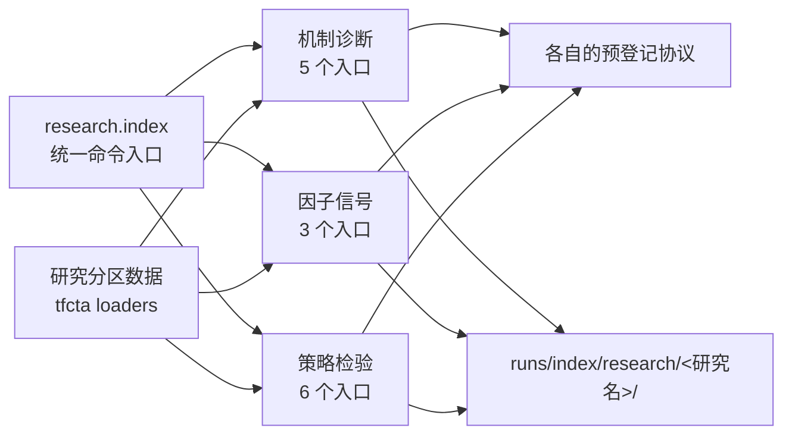
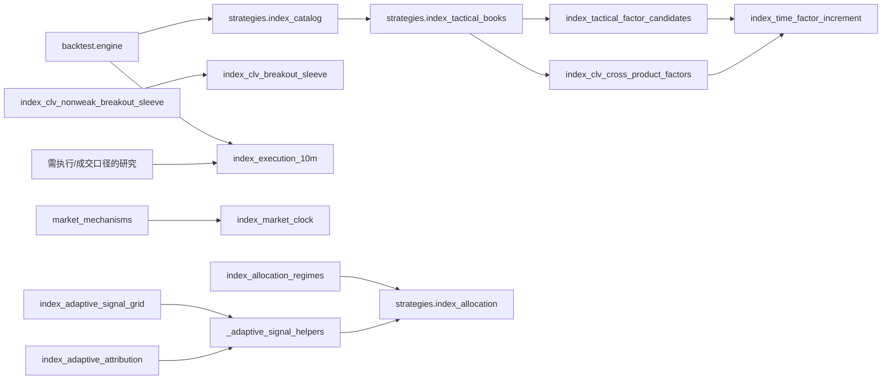

# 股指研究目录

股指研究的统一入口：

```bash
python -m research.index --help
python -m research.index mechanism --help
python -m research.index factor --help
python -m research.index strategy --help
```

形式为 `python -m research.index <方向> <研究名> [该研究原有参数]`。研究实现按方向放在 `mechanisms/`、`factors/`、`strategy_studies/`，共享组件放在 `shared/`；运行研究统一使用此入口。入口只负责分组和转发，不改写各研究的计算、协议或输出。

## 按实际研究问题分类

| 方向 | 统一入口 | 实际问题与实现 | 对应预登记协议 |
|---|---|---|---|
| 弱收盘与经济机制 | `mechanism clv` | CLV、L1、路径形态、反转渠道、流动性提供与被迫卖出；`mechanisms/index_close_location_mechanism.py` | `index_close_location_mechanism.json`、`index_close_location_shape.json`、`index_reversal_channels.json`、`index_liquidity_provision.json`、`index_forced_selling.json` |
| 弱收盘与经济机制 | `mechanism weak-close <close\|price-extremes\|path-volume>` | 弱收盘区分变量、极值形态及路径/量能诊断；`mechanisms/weak_close_diagnostics.py` | `index_close_discriminators.json`、`index_price_extremes.json`、`index_weak_close_shape.json`、`index_path_volume_discriminators.json` |
| 弱收盘与经济机制 | `mechanism weak-close-classifier` | 弱收盘广度、日内路径和 L1 压力的逐年预测增量；`mechanisms/index_weak_close_mechanism_classifier.py` | `index_weak_close_mechanism_classifier.json` |
| 弱收盘与经济机制 | `mechanism market <liquidity\|positioning\|qvix\|intraday-cost>` | 流动性、会员持仓、波动风险补偿与盘中成本；`mechanisms/market_mechanisms.py` | `index_liquidity_mechanism.json`、`index_positioning_mechanism.json`、`index_unabsorbed_pressure.json`、`index_qvix_reversal.json`、`index_intraday_cost_regime.json` |
| 弱收盘与经济机制 | `mechanism spot <long-sample\|open-pressure>` | 现货长样本反转及次日开盘压力；`mechanisms/spot_reversal.py` | `index_spot_long_sample.json`、`index_spot_open_pressure.json` |
| 因子与信号检验 | `factor time-increment` | 时间因子在 CLV、收益和成交量之外的增量检验；`factors/index_time_factor_increment.py` | `index_time_factor_increment.json` |
| 因子与信号检验 | `factor cross-product` | IF/IH/IC 的 CLV 与时间因子异质性；`factors/index_clv_cross_product_factors.py` | `index_clv_cross_product_factors.json` |
| 因子与信号检验 | `factor strategy-candidates` | 纯 CLV、因子候选及倾斜规则复现；`factors/index_tactical_factor_candidates.py` | `index_tactical_factor_candidates.json` |
| 策略与配置检验 | `strategy allocation-regimes` | 品种分配、信号分歧及配置状态；`strategy_studies/index_allocation_regimes.py` | `index_allocation_regimes.json` |
| 策略与配置检验 | `strategy signal-grid` | 预登记单边上涨信号门槛网格；`strategy_studies/index_adaptive_signal_grid.py` | `index_adaptive_signal_grid.json` |
| 策略与配置检验 | `strategy attribution` | 历史策略部件归因及已退役底仓对照；`strategy_studies/index_adaptive_attribution.py` | `index_adaptive_attribution.json`、`index_base_momentum.json`、`index_base_budget_transfer.json` |
| 策略与配置检验 | `strategy breakout` | 当前标准 55/20 趋势袖套研究复现；`strategy_studies/index_clv_breakout_sleeve.py` | `index_clv_breakout_sleeve.json` |
| 策略与配置检验 | `strategy nonweak-breakout` | 已退役非弱收盘突破变体的历史复现；`strategy_studies/index_clv_nonweak_breakout_sleeve.py` | `index_clv_nonweak_breakout_sleeve.json` |
| 策略与配置检验 | `strategy comparison` | 当前三本冻结策略与基准的研究期比较；`strategy_studies/index_selected_strategy_comparison.py` | `index_selected_strategy_comparison.json` |

研究模块不是策略注册表。当前正式策略仍只由 [`strategies/index_catalog.py`](../../strategies/index_catalog.py) 注册；非弱收盘突破和历史归因等研究入口不能据此作为正式策略运行。

## 共享代码与引用关系



### 代码依赖



共享代码的职责：

- `shared/index_execution_10m.py`：开盘 L1 报价、滑点和集合竞价工具；引擎和需要账本/成交核对的研究共用。
- `shared/index_market_clock.py`：机制研究共用的研究期日线和时间因子装载；目前由 `mechanisms/market_mechanisms.py` 使用。
- `shared/_adaptive_signal_helpers.py`：历史自适应信号、波动缩放等计算；由门槛网格和归因研究共用，并复用 `strategies.index_allocation`。
- `factors/index_time_factor_increment.py`：时间因子面板与回归工具供跨品种分析和因子候选使用。
- `strategies/index_common.py`：品种集合、CLV 和价格指标；策略、引擎及因子研究共用。`tfcta.config` / `tfcta.data` 负责分区边界、加载和样本保护。

图中的策略模块会引用因子研究模块：冻结的因子倾斜 book 复用候选研究中的因子投票/目标权重，并通过跨品种研究模块构建研究期因子面板；研究模块同时引用 `strategies.index_common` 等通用计算，不导入具体策略 book，因此当前没有循环导入。这个策略↔研究耦合是已知边界，未来若抽离，应把纯信号计算迁入共享因子层，而不是重复实现。

## 为什么不把所有研究硬并成一个脚本

同属“经济机制”或“因子”的研究，往往有不同的因变量、数据源、样本边界、预登记 JSON 和结果目录。比如盘中 L1、现货开盘、会员持仓和 QVIX 不是同一个检验；把它们压到单一大文件会让协议/数据口径更难辨认。已有真正共享的面板构造、执行和信号 helper 已集中复用；本次统一的是命令入口和研究分类，不合并不同假设的统计实现，也不删除可复现的历史研究。

运行任何入口前，先核对对应 `config/research/` 协议和研究数据范围。统一入口不提供 OOS 权限；研究模块仍须遵守研究期数据边界。
